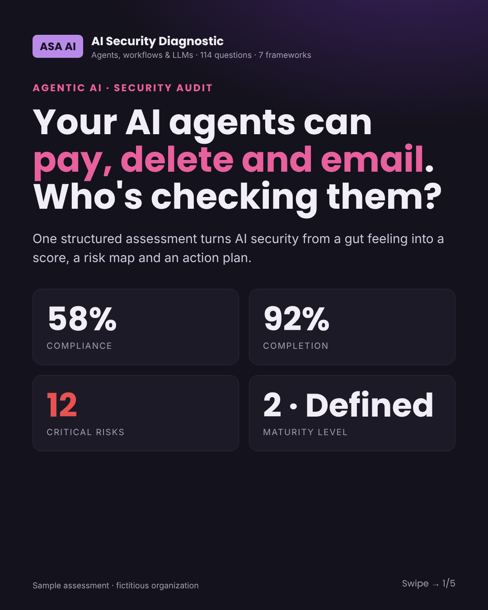
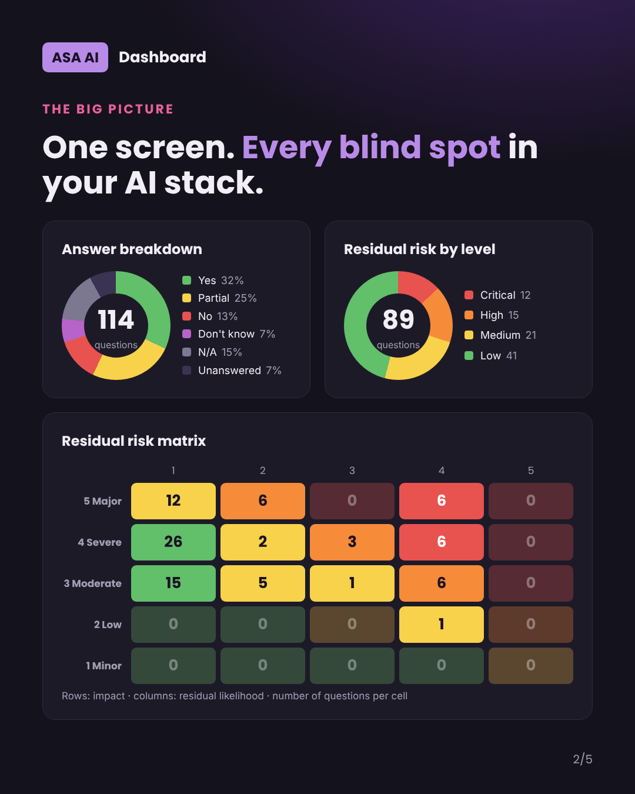
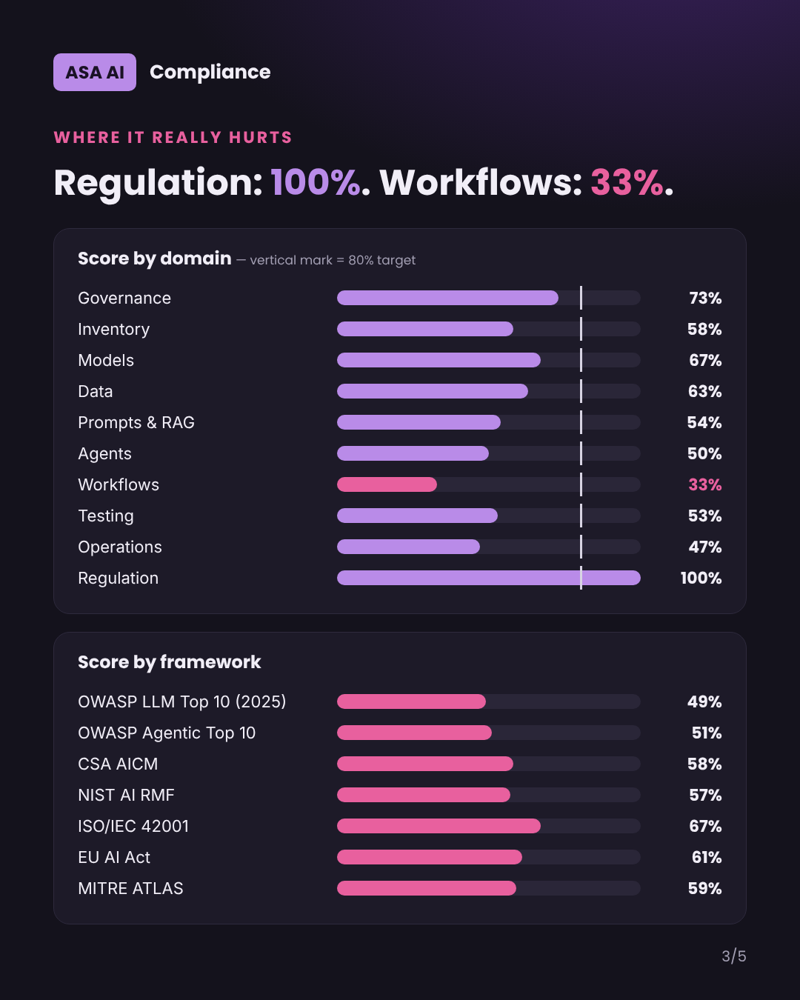
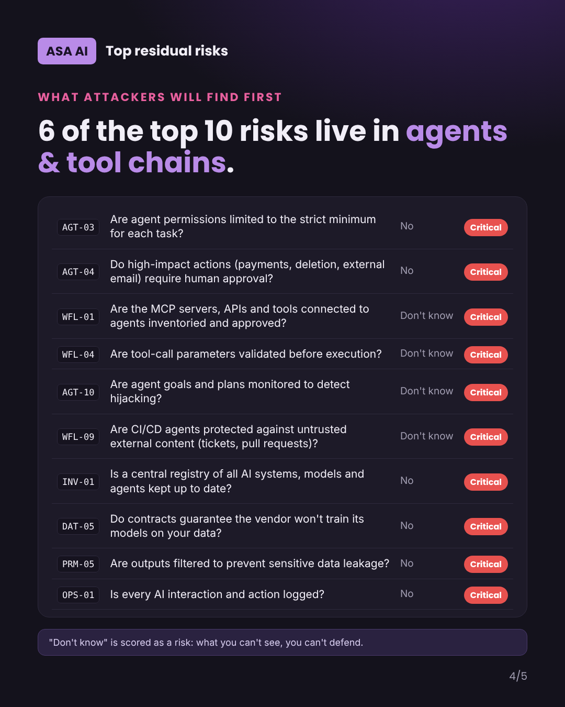
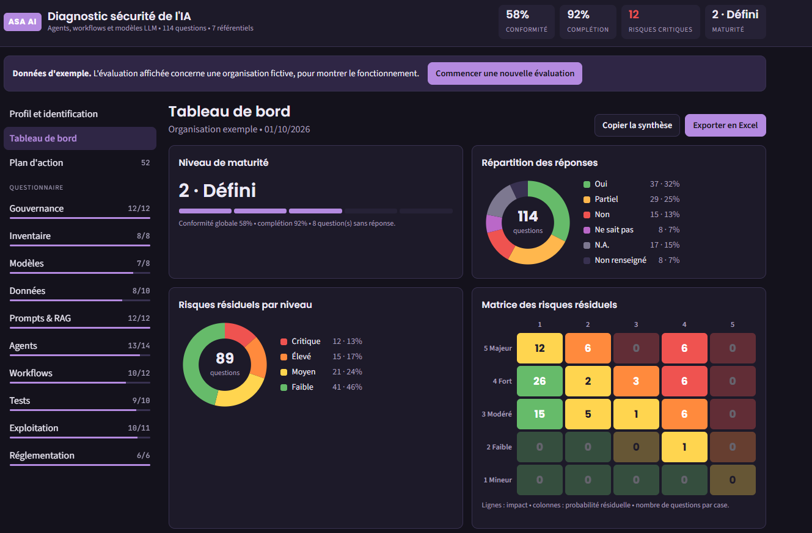
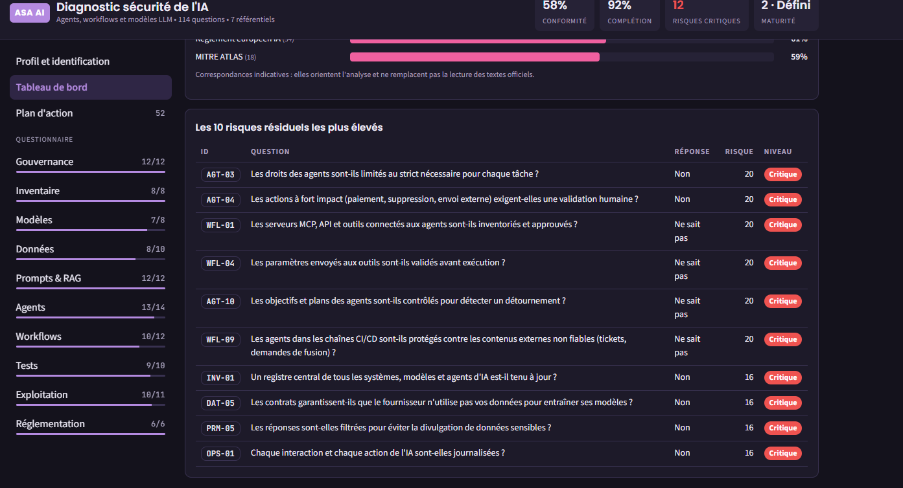

# ASA AI — FlowGuard

### AI Security & Governance Diagnostic · Diagnostic de sécurité et de gouvernance de l'IA

**Agents · Workflows · LLMs — 114 questions, 10 domains, 7 frameworks → a maturity score, a risk map and a prioritized action plan.**

---

---

## 🇬🇧 English

### Your AI agents can pay, delete and email. Who's checking them?

Agentic AI moved faster than anyone's controls. Agents now call tools, hit APIs,
move money and touch production data — and most organizations can't say, with
evidence, whether any of it is governed. **ASA AI FlowGuard** turns that gut
feeling into a **score, a risk map and an action plan** in one structured
assessment.

### What it measures

**114 questions across 10 domains** — Governance, Inventory, Models, Data,
Prompts & RAG, Agents, Workflows, Testing, Operations, Regulation — each mapped
to the frameworks regulators and auditors actually use:

| Framework | Publisher |
|---|---|
| OWASP Top 10 for LLM Applications (2025) | OWASP GenAI Security Project |
| OWASP Top 10 for Agentic Applications | OWASP GenAI Security Project |
| AI Controls Matrix (AICM) | Cloud Security Alliance |
| AI Risk Management Framework | NIST |
| ISO/IEC 42001 (AI Management System) | ISO/IEC |
| EU AI Act | European Union |
| ATLAS (adversarial ML) | MITRE |

### What you get

- A **maturity level** (1–5) and a **global compliance score**
- A **residual-risk matrix** (impact × likelihood) and your **top 10 critical risks**
- A **prioritized remediation plan**, owner and due date per finding
- A **board-ready report** (PDF) and a working **Excel register**

> Answers are simple — **Yes · Partial · No · Don't know · N/A** — and *"Don't know"
> is scored as a risk: what you can't see, you can't defend.*

### See a real assessment

A full **sample report** on a fictitious organization shows exactly what you get:
**[Sample_AI_Security_Audit_Report_EN.pdf](Sample_AI_Security_Audit_Report_EN.pdf)**.

### Get your baseline

The diagnostic is **free to run**. To receive your **full report + action plan +
Excel register**, request access with a professional e-mail and phone on
**[www.asa-ai.fr](https://www.asa-ai.fr)** — or **[book a demo](mailto:contact@asa-ai.fr)**
and we run it with you on your agents, workflows and LLMs.

---

## 🇫🇷 Français

### Vos agents IA peuvent payer, supprimer et envoyer des e-mails. Qui les contrôle ?

L'IA agentique a pris de vitesse les contrôles. Les agents appellent des outils,
des API, déplacent de l'argent et touchent aux données de production — et la
plupart des organisations sont incapables de dire, preuves à l'appui, si tout
cela est gouverné. **ASA AI FlowGuard** transforme cette intuition en un
**score, une cartographie des risques et un plan d'action**, en une seule
évaluation structurée.

### Ce qu'il mesure

**114 questions sur 10 domaines** — Gouvernance, Inventaire, Modèles, Données,
Prompts & RAG, Agents, Workflows, Tests, Exploitation, Réglementation — chacune
rattachée aux référentiels qu'utilisent réellement régulateurs et auditeurs :

| Référentiel | Éditeur |
|---|---|
| OWASP Top 10 for LLM Applications (2025) | OWASP GenAI Security Project |
| OWASP Top 10 for Agentic Applications | OWASP GenAI Security Project |
| AI Controls Matrix (AICM) | Cloud Security Alliance |
| AI Risk Management Framework | NIST |
| ISO/IEC 42001 (système de management de l'IA) | ISO/IEC |
| Règlement européen sur l'IA (EU AI Act) | Union européenne |
| ATLAS (ML adverse) | MITRE |

### Ce que vous obtenez

- Un **niveau de maturité** (1 à 5) et un **score de conformité global**
- Une **matrice des risques résiduels** (impact × probabilité) et vos **10 risques critiques**
- Un **plan de remédiation priorisé**, avec responsable et échéance par constat
- Un **rapport présentable à un comité** (PDF) et un **registre Excel** opérationnel

> Les réponses sont simples — **Oui · Partiel · Non · Ne sait pas · N.A.** — et
> *« Ne sait pas » compte comme un risque : ce qu'on ne voit pas, on ne peut pas le défendre.*

 

### Voir une évaluation réelle

Un **rapport d'exemple** complet sur une organisation fictive montre exactement
le livrable : **[Exemple_Rapport_Audit_Securite_IA_FR.pdf](Exemple_Rapport_Audit_Securite_IA_FR.pdf)**.

### Obtenez votre diagnostic

Le diagnostic est **gratuit**. Pour recevoir votre **rapport complet + plan
d'action + registre Excel**, demandez l'accès avec un e-mail professionnel et un
téléphone sur **[www.asa-ai.fr](https://www.asa-ai.fr)** — ou
**[réservez une démo](mailto:contact@asa-ai.fr)** et nous le réalisons avec vous
sur vos agents, workflows et LLM.

---

**ASA AI** · Savigny-le-Temple, France · [www.asa-ai.fr](https://www.asa-ai.fr) · [contact@asa-ai.fr](mailto:contact@asa-ai.fr)

*Correspondances aux référentiels fournies à titre indicatif ; elles orientent l'analyse et ne remplacent pas la lecture des textes officiels.*
*Framework mappings are indicative and do not replace the official texts.*

